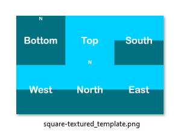
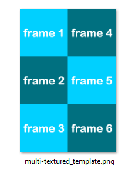
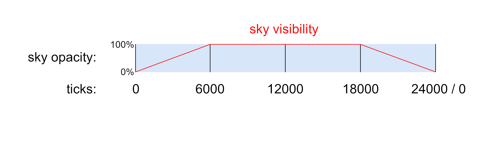
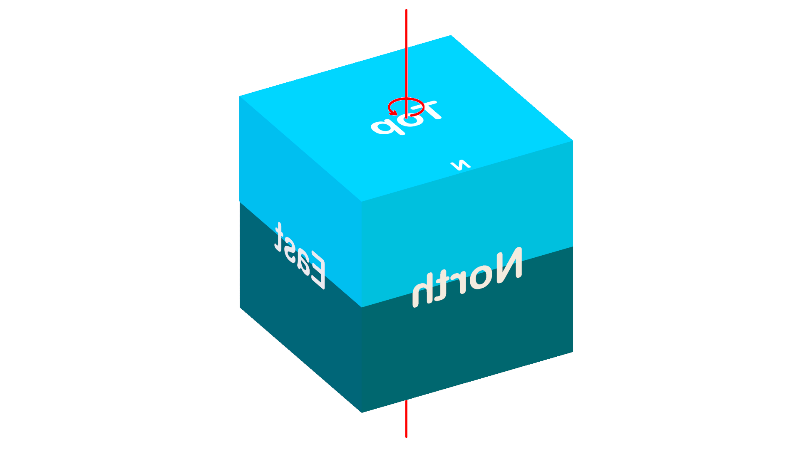

# Specification

This specification defines a format outlining a set of rules for custom sky rendering. These rules can be organized into 9 groups. Please refer to the side panel for the table of contents.

To start writing your configuration for your skybox, create a text file, and save it as a `.json`. The format starts with a `{`  and ends with a `}`. In between you can start adding your parameters from these 9 groups, called `objects`. Each object is separated by a `,` and can be be arranged in any order.

Throughout the document, you will find examples. Additionally, at the bottom of the page, you'll find examples of various skybox types, demonstrating the structure of a complete file.&#x20;

A template resource pack is also provided containing a full day cycle for textures, as well as one of every other type of skybox element to assist you in starting your own pack quickly.

## 1. Schema version

This object is required.

```json
"schemaVersion": 1
```

## 2. Type

There are four types of skyboxes: monocolor-, textured-, decoration-, and vanilla skyboxes. One of the 4 types is required.

"Nuit" can be specified as a namespaced identifier, but it is not a requirement (e.g. `nuit:monocolor`)

### 2.1 Monocolor skybox

<table><thead><tr><th width="240" align="center">Name</th><th align="center">Description</th></tr></thead><tbody><tr><td align="center"><code>nuit:monocolor</code></td><td align="center">Shows a single plain color for the full skybox.</td></tr></tbody></table>

```json
"type": "nuit:monocolor"
```

### 2.2 Textured skyboxes

<table><thead><tr><th width="214" align="center">Name</th><th align="center">Description</th></tr></thead><tbody><tr><td align="center"><code>nuit:square-textured</code></td><td align="center">uses a 3:2 aspect ratio texture file for the skybox</td></tr><tr><td align="center"><code>nuit:multi-textured</code></td><td align="center">uses a grid of textures- arranged in a single texture atlas- for an animation</td></tr></tbody></table>

```json
"type": "nuit:square-textured"
```

Example for `nuit:square-textured` skybox.

<figure><picture><source srcset=".gitbook/assets/square-textured_example_dark.png" media="(prefers-color-scheme: dark)"></picture><figcaption></figcaption></figure>

Example of an animation texture used for the `nuit:multi-textured` skybox type. Frames should be ordered from top to bottom, then left to right as seen below. Each frame can be of any size and aspect ratio. However, the combined size of the texture should not exceed 8192x8192 pixels. Only very recent GPUs can handle textures up to 16384x16384 pixels.

<figure><picture><source srcset=".gitbook/assets/multi-textured_example_dark.png" media="(prefers-color-scheme: dark)"></picture><figcaption></figcaption></figure>

### 2.3 Decoration skybox

<table><thead><tr><th width="211" align="center">Name</th><th align="center">Description</th></tr></thead><tbody><tr><td align="center"><code>nuit:decorations</code></td><td align="center">Shows the Sun, Moon and Stars.</td></tr></tbody></table>

```json
"type": "nuit:decorations"
```

### 2.4 Vanilla skyboxes

<table><thead><tr><th width="211" align="center">Name</th><th align="center">Description</th></tr></thead><tbody><tr><td align="center"><code>nuit:overworld</code></td><td align="center">This will show the overworld's skybox.</td></tr><tr><td align="center"><code>nuit:end</code></td><td align="center">This will show the end's skybox.</td></tr></tbody></table>

```json
"type": "nuit:overworld"
```

## 3. Color

This is exclusive to- and is a requirement for the `monocolor` skybox type.

<table><thead><tr><th width="126" align="center">Name</th><th align="center">Description</th><th width="108" align="center">Required</th><th width="100" align="center">Default</th></tr></thead><tbody><tr><td align="center"><code>red</code></td><td align="center">Specifies the amount of red color to be used. Must be a value between 0 and 1.</td><td align="center">✔️</td><td align="center">-</td></tr><tr><td align="center"><code>green</code></td><td align="center">Specifies the amount of green color to be used. Must be a value between 0 and 1.</td><td align="center">✔️</td><td align="center">-</td></tr><tr><td align="center"><code>blue</code></td><td align="center">Specifies the amount of blue color to be used. Must be a value between 0 and 1.</td><td align="center">✔️</td><td align="center">-</td></tr><tr><td align="center"><code>alpha</code></td><td align="center">Specifies the amount of alpha transparency to be used. Must be a value between 0 and 1.</td><td align="center">❌</td><td align="center"><code>1.0</code></td></tr></tbody></table>

```json
"color": {"red": 0.84, "green": 0.91, "blue": 0.72, "alpha": 1.0}
```

## 4. Texture

This is exclusive to- and is a requirement for the `square-textured` skybox type.

<table><thead><tr><th width="139" align="center">Name</th><th align="center">Description</th></tr></thead><tbody><tr><td align="center"><code>texture</code></td><td align="center">Specifies the directory for the texture file.</td></tr></tbody></table>

```json
"texture": "nuit:sky/skybox.png"
```

## 5. Animatable textures

This is exclusive to- and is a requirement for the `nuit:multi-textured` skybox type. You can incorporate as many animations as needed.&#x20;

The animation texture will cycle through within the designated animation area, determined by the UV range. The number of steps in the cycle is defined by the number of rows and columns on the animation texture.

<table><thead><tr><th width="151" align="center">Name</th><th width="378" align="center">Description</th><th width="109" align="center">Required</th><th width="99" align="center">Default</th></tr></thead><tbody><tr><td align="center"><code>texture</code></td><td align="center">Specifies the location of the texture to be used when rendering the animation</td><td align="center">✔️</td><td align="center"><code>-</code></td></tr><tr><td align="center"><code>uvRange</code></td><td align="center">Specifies the location in UV ranges to render the animation</td><td align="center">✔️</td><td align="center"><code>-</code></td></tr><tr><td align="center"><code>gridColumns</code></td><td align="center">Specifies the amount of columns the animation texture has</td><td align="center">✔️</td><td align="center"><code>-</code></td></tr><tr><td align="center"><code>gridRows</code></td><td align="center">Specifies the amount of rows the animation texture has</td><td align="center">✔️</td><td align="center"><code>-</code></td></tr><tr><td align="center"><code>duration</code></td><td align="center">Specifies the default duration of each animation frame in milliseconds</td><td align="center">✔️</td><td align="center"><code>-</code></td></tr><tr><td align="center"><code>frameDuration</code></td><td align="center">Specifies the specific duration per animation frame, which overrides <code>duration</code></td><td align="center">❌</td><td align="center"><code>-</code></td></tr><tr><td align="center"><code>interpolate</code></td><td align="center">Smoothly fades between the animation frames of the texture</td><td align="center">❌</td><td align="center"><code>true</code></td></tr></tbody></table>

Example for a skybox with 2 animations:

```json
"animatableTextures": [
  {
    "texture": "nuit:sky/anim_texture_1.png",
    "uvRange": {
      "minU": 0.25,
      "minV": 0.25,
      "maxU": 0.5,
      "maxV": 0.5
    },
    "gridColumns": 2,
    "gridRows": 4,
    "duration": 50,
    "frameDuration": {"1": 20, "5": 10}
  },
  {
    "texture": "nuit:sky/anim_texture_2.png",
    "interpolate": false,
    "uvRange": {
      "minU": 0.3333,
      "minV": 0.6666,
      "maxU": 0.2,
      "maxV": 0.4
    },
    "gridColumns": 3,
    "gridRows": 5,
    "duration": 10,
    "frameDuration": {"1": 30, "5": 40}
  }
]
```

### 5.1 UV range

Specifies a UV range object for defining texture coordinates. All fields are required.

<table><thead><tr><th width="257" align="center">Name</th><th align="center">Description</th></tr></thead><tbody><tr><td align="center"><code>minU</code></td><td align="center">Specifies the minimum U coordinate</td></tr><tr><td align="center"><code>minV</code></td><td align="center">Specifies the minimum V coordinate</td></tr><tr><td align="center"><code>maxU</code></td><td align="center">Specifies the maximum U coordinate</td></tr><tr><td align="center"><code>maxV</code></td><td align="center">Specifies the maximum V coordinate</td></tr></tbody></table>

The UV map uses the 3:2 aspect ratio skybox template, as shown in the example below. It is worth noting, that the aspect ratio of your animated area does not necessarily need to match the aspect ratio of the frames in your animation texture. This means, that your frames will be stretched to fit the animation area, even if the aspect ratios do not match. As an example, if your frame is a perfect square, but your animated area is a rectangle, your frame will appear stretched. The texture will only appear inside the animated area, the rest of the skybox will be empty.

<figure><picture><source srcset=".gitbook/assets/UV example_dark.png" media="(prefers-color-scheme: dark)"></picture><figcaption></figcaption></figure>

### 5.2 Frame duration

Overrides the default duration of each frame that is set by `duration`, allowing unique duration for each frame in the animation. All fields are optional. The total number of frames specified should not exceed the number of frames included on the animation texture.

<table><thead><tr><th width="141" align="center">Name</th><th align="center">Description</th></tr></thead><tbody><tr><td align="center"><code>1</code></td><td align="center">Specifies the duration of the 1st animation frame in milliseconds</td></tr><tr><td align="center"><code>2</code></td><td align="center">Specifies the duration of the 2nd animation frame in milliseconds</td></tr><tr><td align="center"><code>3</code></td><td align="center">Specifies the duration of the 3rd animation frame in milliseconds</td></tr><tr><td align="center"><code>4</code></td><td align="center">Specifies the duration of the 4th animation frame in milliseconds</td></tr></tbody></table>

## 6. Decorations

These are exclusive to the decorations skybox type. All objects are optional. For optimal results, the Moon texture should use the same layout as the vanilla Moon texture. The Default values store the overworld Sun and Moon textures and sets all enabled to true.

<table><thead><tr><th width="160" align="center">Name</th><th width="317" align="center">Description</th><th align="center">Default</th></tr></thead><tbody><tr><td align="center"><code>sun</code></td><td align="center">Specifies the location of the texture to be used for rendering the sun.</td><td align="center">Default Sun texture <code>minecraft:textures/environment/sun.png</code></td></tr><tr><td align="center"><code>moon</code></td><td align="center">Specifies the location of the texture to be used for rendering the moon.</td><td align="center">Default Moon texture <code>minecraft:textures/environment/moon_phases.png</code></td></tr><tr><td align="center"><code>showSun</code></td><td align="center">Specifies whether the sun should be rendered.</td><td align="center"><code>true</code></td></tr><tr><td align="center"><code>showMoon</code></td><td align="center">Specifies whether the moon should be rendered.</td><td align="center"><code>true</code></td></tr><tr><td align="center"><code>showStars</code></td><td align="center">Specifies whether the stars should be rendered.</td><td align="center"><code>true</code></td></tr><tr><td align="center"><code>showEndFlash</code></td><td align="center">Specifies whether the End flash should be rendered.</td><td align="center"><code>false</code></td></tr></tbody></table>

```json
"sun": "minecraft:textures/environment/sun.png"
```

```json
"moon": "minecraft:textures/environment/moon_phases.png"
```

```json
"showSun": true
```

```json
"showMoon": true
```

```json
"showStars": true
```

It is worth knowing, that it is possible to specify unique rotation and blending mode for the sun, moon and stars all individually, if they are set to show `true` in 3 separate json files, and the other 2 decorations are set to show `false`. You can also add multiple suns and moons with different blending and/or rotation, if you assign them to multiple different sky layers.

## 7. Blend

Specifies how the skybox should blend with the previously rendered sky layer, the vanilla skybox being the first layer. All fields are optional.

Within Nuit, the blending of textured skyboxes is achieved using `glBlendFunc`. For `decorations`, the blending used aligns with the vanilla game's approach, particularly for the sun and moon blending.

<table><thead><tr><th width="133" align="center">Name</th><th width="476" align="center">Description</th><th align="center">Default</th></tr></thead><tbody><tr><td align="center"><code>type</code></td><td align="center">Specifies the type of the blend for the skybox only. Valid types are: <code>normal</code>, <code>lighten</code>, <code>screen</code>, <code>dodge</code>, <code>add</code>, <code>darken</code>, <code>multiply</code>, <code>burn</code>, <code>subtract</code>, <code>replace</code>, <code>decorations</code> and <code>disable</code>.</td><td align="center"><code>add</code></td></tr></tbody></table>

```json
"blend": {
  "type" : "normal"
}
```

## 8. Properties

Specifies common properties used by all types of skyboxes. All objects are optional.

<table><thead><tr><th width="225" align="center">Name</th><th width="412" align="center">Description</th><th align="center">Default</th></tr></thead><tbody><tr><td align="center"><code>layer</code></td><td align="center">Specifies the order which skybox will be rendered. If there are multiple skyboxes with identical layer number, those skyboxes will be loaded in alphabetical order.</td><td align="center"><code>0</code></td></tr><tr><td align="center"><code>fade</code></td><td align="center">Controls the opacity of the skybox based on the in-game time.</td><td align="center">-</td></tr><tr><td align="center"><code>rotation</code></td><td align="center">Specifies the rotation speed and angles of the skybox.</td><td align="center">-</td></tr><tr><td align="center"><p><code>transitionIn</code></p><p><code>Duration</code></p></td><td align="center">Specifies the duration in ticks that skybox will fade in when valid conditions are changed. The value must be within 1 and 8760000 (365 days * 24000 ticks).</td><td align="center"><code>20</code></td></tr><tr><td align="center"><code>transitionOutDuration</code></td><td align="center">Specifies the duration in ticks that skybox will fade out when valid conditions are changed. The value must be within 1 and 8760000 (365 days * 24000 ticks).</td><td align="center"><code>20</code></td></tr><tr><td align="center"><code>fog</code></td><td align="center">Includes all fog specification. See below for more details.</td><td align="center"><code>-</code></td></tr><tr><td align="center"><code>sunSkyTint</code></td><td align="center">Specifies whether the skybox should disable sunrise/set sky color tinting.</td><td align="center"><code>true</code></td></tr><tr><td align="center"><code>visibleUnderwater</code></td><td align="center">Whether the sky should render when the player is under water.</td><td align="center"><code>true</code></td></tr></tbody></table>

```json
"properties": {
  "layer": 1,
  "fade": { 
    "duration": 24000,
    "alwaysOn": false,
    "keyFrames": {
      "0": 0.0,
      "6000": 0.75,
      "18000": 1.0
      }
  },
  "rotation": {
    "speed": 0.866,
    "mapping": {
      "0": [0.0, 0.0, 0.0],
      "6000": [0.0, 90.0, 0.0]
      },
    "axis": {"0": [0.0, 0.0, 90.0]},
    "skyboxRotation": true
  },
  "transitionInDuration": 200,
  "transitionOutDuration": 300,
  "fog": {
    "modifyColors": true,
    "red": 0.84,
    "green": 0.91,
    "blue": 0.97,
    "modifyDensity": true,
    "density": 1.0,
    "showInDenseFog": true
    },
  "sunSkyTint": true,
  "visibleUnderwater": false
}
```

As you can see, `fade`, `fog`, `rotation` (and its `mapping` and `axis` components) have multiple object within, so let's take a look at those in more detail.

### 8.1 Fade object

All objects are optional.

<table><thead><tr><th width="253" align="center">Name</th><th align="center">Description</th><th width="100" align="center">Default</th></tr></thead><tbody><tr><td align="center"><code>duration</code></td><td align="center">Duration of the loop in ticks that the  keyframes will cycle through.</td><td align="center"><code>24000</code></td></tr><tr><td align="center"><code>keyFrames</code></td><td align="center">Controls when and what opacity the skybox should have.</td><td align="center">-</td></tr></tbody></table>

When no fade objects are specified, the given sky will be rendered at all times.

#### 8.1.1 Keyframes

When using keyframes, you will need to specify the time of day in ticks, and the opacity the sky at that time. You can add any number of time points in your keyframes. The given times should not exceed the `duration` however. The opacity values must be within 0 and 1. Since these keyframes are in a loop, your last keyframe will be followed by your first one.

|  Name |                Description                |
| :---: | :---------------------------------------: |
|   0   |   Opacity of the skybox at 0 tick time.   |
|  6000 |  Opacity of the skybox at 6000 tick time. |
| 12000 | Opacity of the skybox at 12000 tick time. |

Here's a concrete example of how this will work:

```json
"keyFrames": {
      "0": 0.0,
      "6000": 1.0,
      "18000": 1.0
      }
```

<figure><picture><source srcset=".gitbook/assets/key_fade_dark.png" media="(prefers-color-scheme: dark)"></picture><figcaption></figcaption></figure>

Conversion table:

<table><thead><tr><th width="154" align="center">Time in Ticks</th><th width="143" align="center">Clock Time</th></tr></thead><tbody><tr><td align="center">0</td><td align="center">6 AM</td></tr><tr><td align="center">6000</td><td align="center">12 AM</td></tr><tr><td align="center">12000</td><td align="center">6 PM</td></tr><tr><td align="center">18000</td><td align="center">12 PM</td></tr></tbody></table>

### 8.2 Fog

All fields are optional.

<table><thead><tr><th width="198" align="center">Name</th><th width="445" align="center">Description</th><th align="center">Default</th></tr></thead><tbody><tr><td align="center"><code>modifyColors</code></td><td align="center">Whether the fog color should be changed.</td><td align="center"><code>false</code></td></tr><tr><td align="center"><code>red</code></td><td align="center">Specifies the amount of red color to be used for rendering the fog. Must be a value between 0 and 1.</td><td align="center"><code>0</code></td></tr><tr><td align="center"><code>green</code></td><td align="center">Specifies the amount of green color to be used for rendering the fog. Must be a value between 0 and 1.</td><td align="center"><code>0</code></td></tr><tr><td align="center"><code>blue</code></td><td align="center">Specifies the amount of blue color to be used for rendering the fog. Must be a value between 0 and 1.</td><td align="center"><code>0</code></td></tr><tr><td align="center"><code>modifyDensity</code></td><td align="center">Whether the fog density should be changed.</td><td align="center"><code>false</code></td></tr><tr><td align="center"><code>density</code></td><td align="center">Specifies the density of the fog. Must be a value between 0 and 1.</td><td align="center"><code>0</code></td></tr><tr><td align="center"><code>showInDenseFog</code></td><td align="center">Whether the skybox will display in dense fog (ex. Nether and boss overlay)</td><td align="center"><code>true</code></td></tr></tbody></table>

### 8.3 Rotation Object

All fields are optional.

<table><thead><tr><th width="192" align="center">Name</th><th width="356" align="center">Description</th><th align="center">Default</th></tr></thead><tbody><tr><td align="center"><code>mapping</code></td><td align="center">Rotates the default template layout as seen in the <code>square-textured</code> skybox type</td><td align="center"><code>[0,0,0]</code></td></tr><tr><td align="center"><code>axis</code></td><td align="center">Specifies the axis of rotation in degrees</td><td align="center"><code>[0,0,0]</code></td></tr><tr><td align="center"><code>speed</code></td><td align="center">Specifies how many rotations the skybox will do per day. Negative values can be used for reverse rotation.</td><td align="center"><code>0</code></td></tr><tr><td align="center"><code>skyboxRotation</code></td><td align="center">During sunset/rise, the rotation speed for the sun/moon will slow down/speed up. This object can toggle this behavior.</td><td align="center"><code>true</code></td></tr></tbody></table>

`Mapping` allows you to reorient your skybox's default position. For example, you can flip your skybox upside down using this parameter. The `axis` refers to the actual axis, which the skybox will visibly revolve around. The speed parameter determines how many full rotations the sky makes in a single in-game day.

`skyboxRotation` becomes noticeable when the time is set to 12000 or 0. During sunrise and sunset, the sun/moon will be slightly above the horizon. This represents the default behavior for decorations when skyboxRotation is set to `false`. If set to `true`, the sun/moon will align exactly with the horizon line at times 12000 and 0. This adjustment ensures that the rotation parameters function similarly for both the skyboxes and the sun/moon, enhancing the reliability of rotation configuration.

In addition, both `mapping` and `axis` can be keyframed, to change over time. Please refer to 8.1.1 to see examples for keyframing.

#### 8.3.1 Float vector

Specifies a list of three floating-point literals to represent degrees of rotation.

As seen on the image below, the default axis of rotation (`[0,0,0]`) is the Minecraft Y axis (up-down axis), and the sky will rotate clock-wise looking directly up from the player's point of view, when using a positive `speed` value.

<figure><picture><source srcset=".gitbook/assets/axis_dark.png" media="(prefers-color-scheme: dark)"></picture><figcaption></figcaption></figure>

To generate different `axis` or `mapping` values, a Blender tool has been developed courtesy of @UsernameGeri, allowing real-time visualization and adjustment of both values, providing insights into their impact on the skybox's rotation. This tool is compatible with both Nuit and OptiFine.

Instructions for the tool are documented within the blend file. Only the most basic Blender skills are required to utilize this tool, such as navigating the interface and selecting- and rotating objects.



Blender is a free, open source software. Download at [https://www.blender.org/](https://www.blender.org/)

## 9. Conditions

Specifies when and where a skybox should render. All fields are optional.

<table><thead><tr><th width="154" align="center">Name</th><th align="center">Description</th></tr></thead><tbody><tr><td align="center"><code>worlds</code></td><td align="center">Specifies a list of worlds sky effects that the skybox should be rendered in.</td></tr><tr><td align="center"><code>dimensions</code></td><td align="center">Specifies a list of dimension that the skybox should be rendered in.</td></tr><tr><td align="center"><code>weather</code></td><td align="center">Specifies a list of weather conditions that the skybox should be rendered in. Valid entries are <code>clear</code>, <code>rain</code>, <code>thunder</code>, <code>rain_biome</code>, <code>rain_thunder</code>, <code>snow</code> and <code>snow_thunder</code>.</td></tr><tr><td align="center"><code>biomes</code></td><td align="center">Specifies a list of biomes that the skybox should be rendered in.</td></tr><tr><td align="center"><code>xRanges</code></td><td align="center">Specifies a list of coordinates that the skybox should be rendered between.</td></tr><tr><td align="center"><code>yRanges</code></td><td align="center">Specifies a list of coordinates that the skybox should be rendered between.</td></tr><tr><td align="center"><code>zRanges</code></td><td align="center">Specifies a list of coordinates that the skybox should be rendered between.</td></tr><tr><td align="center"><code>effects</code></td><td align="center">Specifies a list of player status effects during which the skybox should be rendered.</td></tr></tbody></table>

```json
"conditions": {
  "worlds": {"entries": ["minecraft:overworld"]},
  "dimensions": {"entries": ["my_datapack:custom_world"]},
  "weather": {"entries": ["rain", "thunder"]},
  "biomes": {
    "entries": ["minecraft:plains", "minecraft:forest", "minecraft:river"],
    "excludes": true
    },
  "xRanges": {"entries": [{"min": -100.0, "max": 100.0}]},
  "yRanges": {"entries": [{"min": -128.0, "max": 150.0}, {"min": 200.0, "max": 320.0}]},
  "zRanges": {"entries": [{"min": -150.0, "max": 150.0}]},
  "effects": {"entries": ["minecraft:jump_boost", "minecraft:speed"]}
}
```

Each condition type has an `entries` and `excludes` object. The `entries` contain all the valid information for that specific condition type. `Excludes` serves a condition inverter, meaning the the sky will be rendered everywhere **but** the specified condition if set to `true`.

|    Name    |     Description     | Required | Default value |
| :--------: | :-----------------: | :------: | :-----------: |
|  `entries` | contains conditions |    ✔️    |      `-`      |
| `excludes` |  inverts conditions |     ❌    |    `false`    |

In addition, `nuit:default` can be used for `worlds`, `dimensions` and `biomes` which will become activated whenever there are no skies active in a given place.

### 9.1 Weather

<table><thead><tr><th width="157" align="center">Name</th><th align="center">Description</th></tr></thead><tbody><tr><td align="center"><code>clear</code></td><td align="center">No precipitation</td></tr><tr><td align="center"><code>rain</code></td><td align="center">World is raining only. No precipitation, i.e. desert biome</td></tr><tr><td align="center"><code>thunder</code></td><td align="center">World is raining and thundering. No precipitation, i.e. desert biome</td></tr><tr><td align="center"><code>rain_biome</code></td><td align="center">World is raining only. Rain precipitation, i.e. plains biome</td></tr><tr><td align="center"><code>rain_thunder</code></td><td align="center">World is raining and thundering. Rain precipitation, i.e. plains biome</td></tr><tr><td align="center"><code>snow</code></td><td align="center">World is raining only. Snow precipitation, i.e. snowy plains biome</td></tr><tr><td align="center"><code>snow_thunder</code></td><td align="center">World is raining and thundering. Snow precipitation, i.e. snowy plains biome</td></tr></tbody></table>

### 9.2 MinMax Entry Object

These objects are used by the `x-y-z range` objects. Multiple `MinMax` entries can be specified within one range.

<table><thead><tr><th width="183" align="center">Name</th><th align="center">Description</th></tr></thead><tbody><tr><td align="center"><code>min</code></td><td align="center">Specifies the minimum value, inclusive</td></tr><tr><td align="center"><code>max</code></td><td align="center">Specifies the maximum value, exclusive</td></tr></tbody></table>

These `MinMax` ranges should be thought of as sections on a number line, rather than incremental steps, like blocks in Minecraft. This means, that you can specify them to a decimal point precision.

Below you can see an example for a smooth transition between 2 skies.

**sky1.json**

```json
"xRanges": [{"min": 0, "max": 4}]
```

**sky2.json**

```json
"xRanges": [{"min": 4, "max": 8}]
```

<figure><picture><source srcset=".gitbook/assets/key_xyzRanges_dark (1).png" media="(prefers-color-scheme: dark)"></picture><figcaption></figcaption></figure>

## Examples and template pack

<details>

<summary>Textured example</summary>

```json
{
  "schemaVersion": 1,
  "type": "nuit:square-textured",
  "texture": "nuit:sky/sky1.png",
  "blend": {"type" : "normal"},
  "properties": {
    "layer": 1,
    "fade": {
      "alwaysOn": false,
      "duration": 24000,
      "keyFrames": {
        "500": 0.0,
        "1500": 1.0,
        "10500": 1.0,
        "11500": 0.0
        }
      },
    "rotation": {
      "speed": 0.0,
      "mapping": {"0": [0.0, 0.0, 0.0]},
      "axis": {"0": [0.0, 0.0, 0.0]}
      },
    "transitionInDuration": 10,
    "transitionOutDuration": 15,
    "fog": {
      "modifyColors": true, "red": 0.0, "green": 0.4, "blue": 0.5,
      "modifyDensity": true, "density": 1.0,
      "showInDenseFog": true
      },
    "sunSkyTint": false
  },
  "conditions": {
    "worlds": {"entries": ["minecraft:overworld"]},
    "dimensions": {"entries": []},
    "weather": {"entries": ["clear", "rain"]},
    "biomes": {"entries": []},
    "xRanges": {"entries": []},
    "yRanges": {"entries": []},
    "zRanges": {"entries": []},
    "effects": {"entries": []}
  }
}
```

</details>

<details>

<summary>Decorations example</summary>

```json
{
  "schemaVersion": 1,
  "type": "nuit:decorations",
  "showSun": true,
  "showMoon": true,
  "showStars": true,
  "properties": {
    "layer": 5,
    "fade": {
      "alwaysOn": true,
      "duration": 24000,
      "keyFrames": {}
      },
    "rotation": {
      "speed": 1.0,
      "mapping": {"0": [0.0, 0.0, 0.0]},
      "axis": {"0": [90.0, 0.0, 0.0]},
      "skyboxRotation": false
      },
    "transitionInDuration": 10,
    "transitionOutDuration": 15,
    "fog": {
      "modifyColors": false, "red": 1.0, "green": 1.0, "blue": 1.0,
      "modifyDensity": false, "density": 1.0,
      "showInDenseFog": true
      },
    "sunSkyTint": false
  },
  "conditions": {
    "worlds": {"entries": ["minecraft:overworld"]},
    "dimensions": {"entries": []},
    "weather": {"entries": ["clear"]},
    "biomes": {"entries": []},
    "xRanges": {"entries": []},
    "yRanges": {"entries": []},
    "zRanges": {"entries": []},
    "effects": {"entries": []}
  }
}
```

</details>


